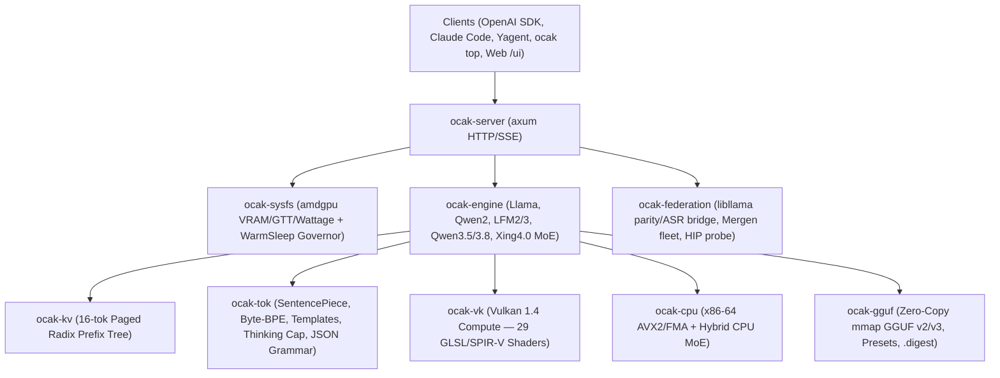

# Ocak

**Ocak** (*hearth / forge*) is a ground-up Rust LLM inference engine, GPU VRAM/power orchestrator, and multi-protocol API server built directly on **Vulkan 1.3/1.4 Compute (`ash` + 29 custom GLSL/SPIR-V shaders)** and **x86-64 AVX2/FMA** — with zero CUDA or ROCm SDK required to build or run.

Designed and verified on a consumer Linux workstation (**AMD Ryzen 5 5600 + Radeon RX 6700 XT 12 GiB VRAM, Mesa RADV Vulkan 1.4**), Ocak runs dense, hybrid-recurrent, and hybrid GPU+CPU Mixture-of-Experts GGUF models natively from 1B up to 29B parameters while automatically curing AMD RDNA 2's 54W idle compute clock-lock bug.

---

## Highlights

- **Ground-up GPU compute engine (`ocak-vk`)**: Raw `ash` Vulkan 1.3/1.4 compute pipeline with 29 hand-written GLSL shaders compiled at build time via `glslc` — zero graphics/render middleware, single `vkQueueSubmit` forward pass per token, and full `VkDevice` teardown on idle sleep.
- **Zero-copy GGUF v2/v3 & 15 quantization formats (`ocak-gguf`, `ocak-cpu`, `ocak-vk`)**: Direct `mmap` loading with stat-verified `.digest` SHA-256 caching and native `models-preset.ini` parsing.
  - Supported formats: `F32`, `F16`, `BF16`, `Q4_0`, `Q4_1`, `Q5_0`, `Q5_1`, `Q8_0`, `Q2_K`, `Q3_K`, `Q4_K`, `Q5_K`, `Q6_K`, `IQ2_XS`, `IQ3_XXS`, `IQ3_S`, `IQ4_NL`, `IQ4_XS`.
- **Native architectures (`ocak-engine`)**:
  - **Llama / MiniCPM / Qwen2** (dense GQA + NeoX / adjacent RoPE)
  - **Liquid LFM2 / LFM2.5** (causal `ShortConv` + QK-norm GQA)
  - **Liquid LFM3** (`ShortConv` + per-head sigmoid attention gate + sliding-window attention + `rope_freqs` + post-attention/FFW norms)
  - **Qwen3.5 / Qwen3.8 / RVN** (3:1 hybrid **Gated DeltaNet** linear recurrence + **Gated Full Attention** + partial NeoX RoPE)
  - **Xing4.0 MoE (29B-A4B)** (4-stream Sinkhorn **Hyper-Connections** + **YaRN MLA** latent KV cache + 64-expert / 4-active MoE + shared expert with automatic hybrid GPU+CPU expert offloading `n_cpu_moe`)
- **Radix Prefix Paged KV Cache (`ocak-kv`)**: 16-token physical KV pages organized in a Copy-on-Write Radix prefix tree with LRU zero-ref leaf eviction for instant multi-turn prefix reuse.
- **RX 6700 XT 12 GiB VRAM & `WarmSleep` Power Governor (`ocak-sysfs`)**: Auto-discovers `amdgpu` DRM/hwmon sensors (VRAM, GTT, wattage, temperature, busy %) and destroys active Vulkan compute contexts after `sleep-idle-seconds`, dropping GPU idle draw back to desktop idle (~29 W) while waking from Linux page cache in ~300 ms.
- **Multi-Protocol Server (`ocak-server`)**:
  - **OpenAI API**: `GET /v1/models`, `POST /v1/chat/completions` (sync + streaming SSE + JSON grammar mode + `<think>` token budget), `POST /v1/completions`, `POST /v1/embeddings` (L2-normalized), `POST /v1/audio/transcriptions`
  - **Anthropic Messages API**: `POST /v1/messages` (streaming SSE `message_start` / `content_block_delta` / `message_stop`) & `POST /v1/messages/count_tokens` — compatible with Claude Code (`ANTHROPIC_BASE_URL=http://127.0.0.1:8090`)
  - **Observability & UI**: Prometheus `GET /metrics`, live SSE `GET /v1/ocak/events`, embedded dark-mode Web dashboard at `GET /ui`, and zero-dependency ANSI terminal monitor (`ocak top`).
- **Tiered Federation & Parity Harness (`ocak-federation`)**: Optional `libllama.so` C logit parity oracle (`ocak parity-test`), managed `llama-server` fallback bridge (for exotic/multimodal audio models like `Qwen3-ASR-1.7B`), `mergen` distributed fleet bridge, and runtime `dlopen` HIP probe.

---

## Architecture



---

## Verified Benchmarks (Ryzen 5 5600 + RX 6700 XT, Mesa RADV Vulkan 1.4)

Measured natively on `ocak-vk` and cross-checked against `libllama.so` via `ocak parity-test`:

| Model | Architecture | Size | Vulkan vs CPU `cos_sim` | Vulkan vs `libllama.so` `cos_sim` | Native Decode |
| :--- | :--- | :---: | :---: | :---: | :---: |
| `tinyllama-1.1b-chat-v1.0.Q4_0` | `llama` | 0.59 GB | `1.000000` | `0.999894` | **168.0 tok/s** |
| `tinyllama-1.1b-chat-v1.0.Q4_K_M` | `llama` | 0.62 GB | `1.000000` | `0.999802` | **143.7 tok/s** |
| `LFM3-1.7B-AD-Q6_K` | `lfm3` (ShortConv + Gated SWA) | 1.48 GB | `1.000000` | *native-only* | **73.3 tok/s** |
| `minicpm5-2b-abliterated-Q4_K_M` | `llama` | 1.45 GB | `1.000000` | `0.999706` | **62.6 tok/s** |
| `LFM2.5-2.6B-Q4_K_M` | `lfm2` (ShortConv + GQA) | 1.56 GB | `1.000000` | `0.999716` (1-tok) | **52.3 tok/s** |
| `Qwen3.5-4B-Q4_K_M` | `qwen35` (Gated DeltaNet + Attn) | 2.55 GB | `1.000000` | `0.999335` | **34.2 tok/s** |
| `Qwopus3.5-9B-coder-Exp-Q4_K_M` | `qwen35` (9B Hybrid) | 5.24 GB | `1.000000` | `0.999584` | **19.9 tok/s** |
| `RVN-IQ2_S-mtp` | `qwen35` (27B Hybrid, `IQ2_XS`/`IQ3_S`) | 9.14 GB | — | greedy verified | **7.0 tok/s** |
| `Xing4.0-29B-A4B-IQ3_XXS` | `xing4_0` (29B MoE, `gpu_moe=29, cpu_moe=8`) | 10.79 GB | — | greedy verified | **1.7 tok/s*** |

*\*`XingExec` currently dispatches individual GPU mat-vecs synchronously per layer; single-command-buffer fused MoE/MLA dispatch is the next optimization target.*

- **`WarmSleep` idle power check**: Active VRAM `1.79 GiB` -> `1.07 GiB` on teardown, RX 6700 XT power returns to **`29.0 W`** idle, automatic wake on next request in **`307 ms`**.
- **Radix KV prefix cache**: Verified 100% prefix hit (`cache_n=48` on 48-token conversation prefix).

---

## Prerequisites & Build

- **Rust** (`cargo`, `rustc` 1.80+)
- **Vulkan 1.3+ runtime & driver** (e.g., Mesa RADV on AMD, NVIDIA Vulkan, Intel ANV)
- **Shader compiler**: `glslc` (`shaderc` package on Arch/Ubuntu/Fedora)

```bash
git clone https://github.com/Mechres/ocak.git
cd ocak
cargo build --release --workspace
```

Run the full test suite (including Vulkan GPU shader parity tests):

```bash
cargo test --release --workspace
```

---

## Quickstart

### 1. Inspect Hardware & Model Catalog
```bash
./target/release/ocak hw
./target/release/ocak inspect --models-dir ~/models
```

### 2. Run Native Inference Directly from CLI
```bash
./target/release/ocak run \
  --model ~/models/Qwen3.5-4B-Q4_K_M.gguf \
  --prompt "<|im_start|>user\nExplain paged attention in two sentences.<|im_end|>\n<|im_start|>assistant\n" \
  --max-tokens 96
```

### 3. Start the Server (`ocakd`) + Web Dashboard & TUI
```bash
./target/release/ocakd \
  --host 127.0.0.1 \
  --port 8090 \
  --compat-port 11434 \
  --models-dir ~/models \
  --sleep-idle-seconds 120
```

- **Web Dashboard**: `http://127.0.0.1:8090/ui`
- **Live Terminal Monitor**: `./target/release/ocak top --addr 127.0.0.1:8090`
- **Claude Code / Anthropic clients**:
  ```bash
  ANTHROPIC_BASE_URL=http://127.0.0.1:8090 ANTHROPIC_API_KEY=local claude
  ```
- **Systemd user service**:
  ```bash
  mkdir -p ~/.config/systemd/user
  cp packaging/ocakd.service ~/.config/systemd/user/
  systemctl --user daemon-reload && systemctl --user enable --now ocakd.service
  ```

---

## Workspace Layout

| Crate | Purpose |
| :--- | :--- |
| `crates/ocak-sysfs` | Linux `amdgpu` DRM/hwmon telemetry + 12 GiB VRAM/power governor |
| `crates/ocak-gguf` | Zero-copy `mmap` GGUF v2/v3 parser, quant reference math, IQ lookup tables, presets, `.digest` |
| `crates/ocak-kv` | 16-token paged KV allocator + Copy-on-Write Radix prefix tree |
| `crates/ocak-tok` | SentencePiece & byte-level BPE tokenizers, chat templates, `<think>` budget, JSON grammar |
| `crates/ocak-cpu` | x86-64 AVX2/FMA quantized GEMV and hybrid transformer ops |
| `crates/ocak-vk` | Raw `ash` Vulkan 1.4 compute runtime + 29 GLSL/SPIR-V shaders |
| `crates/ocak-engine` | Native executors (`VkExec`, `CpuExec`, `XingExec`) + sampler + streaming generator |
| `crates/ocak-federation` | `libllama.so` parity oracle, managed bridge, `mergen` fleet bridge, HIP `dlopen` probe |
| `crates/ocak-server` | `axum` OpenAI + Anthropic + Embeddings + Audio + Prometheus + embedded `/ui` |
| `crates/ocak-cli` | `ocakd` daemon & `ocak` CLI (`hw`, `inspect`, `run`, `parity-test`, `top`) |

---

## Roadmap

- [x] **M1–M3**: Ground-up GGUF/tokenizer/Radix KV, Vulkan 1.4 + AVX2 Llama/Qwen2 engine, OpenAI + Anthropic + Embeddings + Web UI/TUI + RX 6700 XT `WarmSleep`.
- [x] **M4 / M4b**: Native `LFM2`, `LFM3`, `Qwen3.5`/`Qwen3.8` Gated DeltaNet & Gated Attention, `Q2_K`/`Q3_K` & `IQ2_XS`/`IQ3_XXS`/`IQ3_S`/`IQ4_NL`/`IQ4_XS` shaders (10 native models up to 27B).
- [x] **M5**: Native hybrid GPU+CPU MoE for `Xing4.0-29B-A4B` (4-stream Hyper-Connections + YaRN MLA + 64-expert MoE).
- [ ] **M5b**: Single-command-buffer fused GPU MoE + MLA shaders to accelerate `Xing4.0` decode and support `Inkling-2-Mini` looped MoE natively.
- [ ] **M6**: Native `RVN` MTP speculative draft loop, native `Qwen3-ASR` audio frontend, and dynamic `ocak-hip` HSACO launcher.

---

## License

MIT — see [LICENSE](LICENSE).
