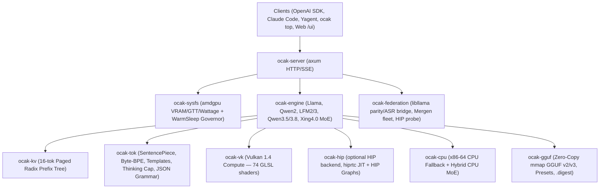

# Ocak

**Ocak** (*hearth / forge*) is a ground-up Rust LLM & ASR inference engine, GPU VRAM/power orchestrator, and multi-protocol API server built directly on **Vulkan 1.3/1.4 Compute (`ash` + 74 custom GLSL compute shaders (218 SPIR-V modules) with `VK_KHR_push_descriptor`, Wave32 `subgroupClusteredAdd`, 100% coalesced `qmv` decode, GPU `argmax`, LDS-tiled `qmm` prefill, fused `add_rms_norm`, 2-token MTP speculative verify, 1-submit-per-token full-GPU pipelines, & host-memory GTT overflow)** and an **x86-64 CPU fallback** (compiled with AVX2/FMA target flags) — with zero CUDA or ROCm SDK required to build or run. An optional **HIP backend (`ocak-hip`)** loads the ROCm runtime at run time when it is installed.

Designed and verified on a consumer Linux workstation (**AMD Ryzen 5 5600 + Radeon RX 6700 XT 12 GiB VRAM, Mesa RADV Vulkan 1.4**), Ocak runs dense, hybrid-recurrent, looped MoE, and hybrid GPU+CPU Mixture-of-Experts GGUF models natively from 1B up to 29B parameters while automatically curing AMD RDNA 2's 54W idle compute clock-lock bug.

---

## Highlights

- **Ground-up GPU compute engine (`ocak-vk`)**: Raw `ash` Vulkan 1.3/1.4 compute pipeline with 74 hand-written GLSL shaders (218 SPIR-V modules with per-format variants) compiled in parallel at build time via `glslc` or `glslangValidator` — zero graphics/render middleware, `VK_KHR_push_descriptor` zero-allocation dispatch, hardware `subgroupClusteredAdd(32)` reductions, 100% coalesced super-block `qmv` decode & Wave32 GPU `argmax` (4-byte greedy readback), fused `add_rms_norm`, 8-row LDS shared-memory tiled `qmm` prefill across 8 formats, int8 dot-product prefill matmuls and flash-style attention, `HOST_VISIBLE` GTT tensor placement for >12 GiB MoE models, deferred parallel barriers with single `vkQueueSubmit` forward pass per token across dense, hybrid-recurrent, and MoE architectures, and full `VkDevice` teardown on idle sleep.
- **Optional HIP backend (`ocak-hip`, `--backend hip`)**: `dlopen`s `libamdhip64.so` + `libhiprtc.so` at run time (no ROCm needed to build), JIT-compiles HIP C++ kernels with an on-disk HSACO cache, and runs dense and hybrid-recurrent models (Llama, LFM2/3, Qwen3.5/3.8) with HIP Graph decode, Split-K attention, `v_dot4` int8 prefill, all K-quant and IQ formats, and GPU MTP verify. Greedy output matches Vulkan; MTP is only attached when it fits in free VRAM. Xing and Inkling (MoE) fall back to Vulkan.
- **Zero-copy GGUF v2/v3 & 20 Vulkan / 20 CPU quantization formats (`ocak-gguf`, `ocak-cpu`, `ocak-vk`)**: Direct `mmap` loading with stat-verified `.digest` SHA-256 caching and native `models-preset.ini` parsing.
  - Vulkan + CPU (20): `F32`, `F16`, `BF16`, `Q4_0`, `Q8_0`, `Q2_K`, `Q3_K`, `Q4_K`, `Q5_K`, `Q6_K`, `IQ1_S`, `IQ1_M`, `IQ2_XXS`, `IQ2_XS`, `IQ2_S`, `IQ3_XXS`, `IQ3_S`, `IQ4_NL`, `IQ4_XS`, `NVFP4` (plus `Q4_1`, `Q5_0`, `Q5_1` on CPU).
- **Native architectures (`ocak-engine`)**:
  - **Llama / Qwen2** (dense GQA + NeoX / adjacent RoPE; also runs `llama`-architecture MiniCPM GGUFs)
  - **Liquid LFM2 / LFM2.5** (causal `ShortConv` + QK-norm GQA)
  - **Liquid LFM3** (`ShortConv` + per-head sigmoid attention gate + sliding-window attention + `rope_freqs` + post-attention/FFW norms)
  - **Qwen3.5 / Qwen3.8 / RVN** (3:1 hybrid **Gated DeltaNet** linear recurrence + **Gated Full Attention** + partial NeoX RoPE + native **NextN MTP** draft head `MtpDrafter`)
  - **Xing4.0 MoE (29B-A4B)** (4-stream Sinkhorn **Hyper-Connections** + **YaRN MLA** latent KV cache + 64-expert / 4-active MoE + shared expert with fused GPU MoE dispatch, parallel MLA, native `<_user>`/`<_bot>` chat template, and automatic hybrid GPU+CPU expert offloading `n_cpu_moe`)
  - **Inkling-2-Mini (26.4B Looped MoE)** (24 physical layers with middle 12 looped 3× = 48 logical layers, depth-wise Attention Residuals, cross-pass gain/forget controllers, dynamic `ShortConv`, relative-position bias + attention sinks, GPU `situ.comp` activation, native `<|message_user|>`/`<|message_model|>` chat template, 128-expert / 8-active `NVFP4` MoE on VRAM + GTT overflow)
  - **Qwen3-ASR-1.7B (Native Audio)** (zero-dep WAV/16 kHz resampler + 128-bin Slaney log-mel spectrogram + `qwen3a` 3×Conv2D + 24-layer Transformer audio encoder + `qwen3vl` Vulkan decoder for `/v1/audio/transcriptions` and `ocak asr`)
- **Radix Prefix Paged FP16 KV Cache & Continuous Multi-Slot Batching (`ocak-kv`, `ocak-vk`, `ocak-server`)**: 16-token packed `F16` (`packHalf2x16`) physical KV pages across all GPU executors (`VkExec`, `MtpDrafter`, `XingExec` MLA, `InklingExec`) with hardware Wave32 `subgroupClusteredAdd` attention, continuous multi-slot request batching (`BatchCoordinator` + `forward_multi_slot` up to 8 concurrent slots), and Radix prefix tree with LRU eviction.
- **RX 6700 XT 12 GiB VRAM & `WarmSleep` Power Governor (`ocak-sysfs`)**: Auto-discovers `amdgpu` DRM/hwmon sensors (VRAM, GTT, wattage, temperature, busy %) and destroys active Vulkan compute contexts after `sleep-idle-seconds`, dropping GPU idle draw back to desktop idle (~29 W) while waking from Linux page cache in ~300 ms.
- **Multi-Protocol Server (`ocak-server`)**:
  - **OpenAI API**: `GET /v1/models`, `POST /v1/chat/completions` (sync + streaming SSE + native `tools`/`tool_calls` function calling + JSON grammar mode + `<think>` token budget), `POST /v1/completions`, `POST /v1/embeddings` (L2-normalized), `POST /v1/audio/transcriptions`
  - **Anthropic Messages API**: `POST /v1/messages` (streaming SSE `message_start` / `content_block_delta` / `tool_use` + `input_json_delta` / `max_tokens` / `message_stop`) & `POST /v1/messages/count_tokens` — compatible with Claude Code (`ANTHROPIC_BASE_URL=http://127.0.0.1:8090`)
  - **Security & Observability**: Loopback `Host`-header DNS-rebinding protection, optional `--api-key` / `OCAK_API_KEY` bearer & `x-api-key` auth on `/v1/*`, Prometheus `GET /metrics`, live SSE `GET /v1/ocak/events`, embedded dark-mode Web dashboard at `GET /ui`, and zero-dependency ANSI terminal monitor (`ocak top`).
- **Tiered Federation & Parity Harness (`ocak-federation`)**: Optional `libllama.so` C logit parity oracle (`ocak parity-test`), managed `llama-server` fallback bridge (for exotic/multimodal audio models like `Qwen3-ASR-1.7B`), `mergen` distributed fleet bridge, and runtime `dlopen` HIP probe.

---

## Architecture



---

## Verified Benchmarks (Ryzen 5 5600 + RX 6700 XT, Mesa RADV Vulkan 1.4)

Throughput from the GPU CI baseline ([`ci/bench-baseline.md`](ci/bench-baseline.md): `ocak bench --prompt-tokens 512 --decode-tokens 64`, re-measured on every push to `master`); parity cross-checked with `ocak parity-test` against the CPU path and `libllama.so`:

| Model | Architecture | Size | Vulkan vs `libllama.so` `cos_sim` | Prefill (512 tok) | Decode |
| :--- | :--- | :---: | :---: | :---: | :---: |
| `LFM3-1.7B-AD-Q6_K` | `lfm3` (ShortConv + Gated SWA) | 1.48 GiB | *native-only* | 4040.8 tok/s | **170.2 tok/s** |
| `minicpm5-2b-abliterated-Q4_K_M` | `llama` | 1.45 GiB | `0.999706` | 2730.5 tok/s | **128.9 tok/s** |
| `LFM2.5-2.6B-Q4_K_M` | `lfm2` (ShortConv + GQA) | 1.56 GiB | `0.999716` (1-tok) | 2624.5 tok/s | **155.5 tok/s** |
| `Qwen3.5-4B-Q4_K_M` | `qwen35` (Gated DeltaNet + Attn) | 2.55 GiB | `0.999336` | 1836.9 tok/s | **96.2 tok/s** |
| `Qwopus3.5-9B-coder-Exp-Q4_K_M` | `qwen35` (9B Hybrid) | 5.24 GiB | `0.999584` | 976.6 tok/s | **59.5 tok/s** |
| `Ornith-1.5-9B-Q4_K_M` | `qwen35` (9B Hybrid + MTP) | 5.38 GiB | — | 840.8 tok/s | **68.7 tok/s** |
| `Qwen3.8-27B-UD-IQ2_S` | `qwen35` (27B Hybrid, `IQ1_S`/`IQ1_M`/`IQ2_XXS`/`IQ2_S`) | 7.80 GiB | greedy verified | 296.7 tok/s | **34.6 tok/s** |
| `RVN-IQ2_S-mtp` | `qwen35` (27B Hybrid + GPU MTP) | 9.14 GiB | lossless MTP | 266.9 tok/s | **40.2 tok/s** |
| `Xing4.0-29B-A4B-IQ3_XXS` | `xing4_0` (29B MoE, MLA, FP16 KV) | 10.79 GiB | greedy verified | 987.1 tok/s | **38.2 tok/s** |
| `Inkling-2-Mini-UD-Q4_K_XL` | `inkling2_loop` (26.4B 3× looped `NVFP4`/`Q8_0` MoE, FP16 KV) | 16.42 GiB | greedy verified | 592.9 tok/s | **18.4 tok/s** |
| `Qwen3-ASR-1.7B` | `qwen3a` + `qwen3vl` (Native Audio) | 2.35 GiB | end-to-end WAV verified | — | **1.49 s / clip** |

Decode in the CI table is measured right after a 512-token prompt; short-prompt greedy decode is higher (e.g. Xing ~47 tok/s, Inkling ~25 tok/s), and MTP models gain further with `OCAK_MTP_DRAFTS`. `docs/PERFORMANCE.md` logs how each number was reached and what was tried and rejected.

HIP backend (`--backend hip`), from [`ci/bench-baseline-hip.md`](ci/bench-baseline-hip.md) (same settings, also checked on every push, together with a HIP long-context `count-test`):

| Model | Prefill (512 tok) | Decode |
| :--- | :---: | :---: |
| `LFM3-1.7B-AD-Q6_K` | 3692.4 tok/s | **157.6 tok/s** |
| `minicpm5-2b-abliterated-Q4_K_M` | 2353.6 tok/s | **129.2 tok/s** |
| `LFM2.5-2.6B-Q4_K_M` | 2785.8 tok/s | **147.0 tok/s** |
| `Qwen3.5-4B-Q4_K_M` | 1809.5 tok/s | **88.0 tok/s** |
| `Qwopus3.5-9B-coder-Exp-Q4_K_M` | 996.7 tok/s | **55.3 tok/s** |
| `Ornith-1.5-9B-Q4_K_M` (MTP) | 951.5 tok/s | **85.4 tok/s** |
| `Qwen3.8-27B-UD-IQ2_S` | 302.5 tok/s | **30.7 tok/s** |
| `RVN-IQ2_S-mtp` (MTP) | 284.7 tok/s | **47.6 tok/s** |
| `Qwen3.8-27B.i1-Q2_K` | 289.1 tok/s | **27.3 tok/s** |

HIP prefill is faster than Vulkan on short prompts (up to ~1.8x below 100 tokens). At 512+ tokens it is about even with Vulkan, and decode is 5-15% slower. The HIP runtime uses ~350 MiB more VRAM than Vulkan, so on the 12 GiB card the 10 GiB `Qwen3.8-27B.i1-Q2_K` runs without MTP under HIP. Vulkan stays the default backend.

- **Native NextN MTP draft verification (`ocak mtp-test`)**: Verified on 27B `RVN-IQ2_S-mtp` (`"The capital of France is"` -> trunk `+1`: `" Paris"`, MTP draft `+2`: `"."`, trunk verify `+2`: `"."`, `match=true`). Greedy output with MTP on and off is identical (lossless).
- **1-submit-per-token batched full-GPU MoE (`XingExec` & `InklingExec`)**: zero per-layer CPU↔GPU fence waits, top-k-batched MoE dispatches, device-side greedy argmax, and 3×-looped-core VRAM priority for Inkling (experts that do not fit the 12 GiB card live in host-visible GTT memory).
- **`WarmSleep` idle power check**: Active VRAM `1.79 GiB` -> `1.07 GiB` on teardown, RX 6700 XT power returns to **`29.0 W`** idle, automatic wake on next request in **`307 ms`**.
- **Radix KV prefix cache**: Verified 100% prefix hit (`cache_n=48` on 48-token conversation prefix).

---

## Prerequisites & Build

- **Rust** (`cargo`, `rustc` 1.80+)
- **Vulkan 1.3+ runtime & driver** with 32-wide (or wider) subgroups. Developed and tested on Mesa RADV (AMD RDNA2); the kernels assume Wave32 reductions (`subgroupClusteredAdd(..., 32)`), so other drivers are untested and devices reporting a subgroup size below 32 are rejected
- **Shader compiler**: `glslc` (`shaderc`) or `glslangValidator` (`glslang-tools`)
- *Optional, for `--backend hip`*: the ROCm HIP runtime and HIPRTC (`libamdhip64.so` and `libhiprtc.so`, in the default library path or `/opt/rocm/lib`; on Arch, `hip-runtime-amd`). Tested with ROCm 10.1 (`libamdhip64.so.7`) on `gfx1031` (RX 6700 XT). Compiled kernels are cached in `$XDG_CACHE_HOME/ocak/hip` (or `~/.cache/ocak/hip`); set `OCAK_HIP_CACHE_DISABLE=1` to bypass the cache

```bash
git clone https://github.com/Mechres/ocak.git
cd ocak
cargo build --release --workspace
```

Run the full test suite (including Vulkan GPU shader parity tests, and HIP kernel parity tests when the ROCm runtime is present):

```bash
cargo test --release --workspace
```

---

## Quickstart

### 1. Inspect Hardware & Model Catalog
```bash
./target/release/ocak hw
./target/release/ocak inspect --models-dir ~/models
```

### 2. Run Native Inference Directly from CLI
```bash
./target/release/ocak run \
  --model ~/models/Qwen3.5-4B-Q4_K_M.gguf \
  --prompt "<|im_start|>user\nExplain paged attention in two sentences.<|im_end|>\n<|im_start|>assistant\n" \
  --max-tokens 96
```
Add `--backend hip` to use the HIP backend (also accepted by `ocakd`, `ocak bench` and `ocak count-test`).

### 3. Start the Server (`ocakd`) + Web Dashboard & TUI
```bash
./target/release/ocakd \
  --host 127.0.0.1 \
  --port 8090 \
  --models-dir ~/models \
  --sleep-idle-seconds 120
```
*(Optional: pass `--compat-port 11434` to mirror the same OpenAI-compatible routes on a second port — note it does not implement Ollama `/api/*` endpoints; pass `--api-key` or `OCAK_API_KEY` to require bearer/`x-api-key` auth on `/v1/*`; binding `--host 0.0.0.0` automatically enables remote `Host` headers.)*

- **Web Dashboard**: `http://127.0.0.1:8090/ui`
- **Live Terminal Monitor**: `./target/release/ocak top --addr 127.0.0.1:8090`
- **Claude Code / Anthropic clients**:
  ```bash
  ANTHROPIC_BASE_URL=http://127.0.0.1:8090 ANTHROPIC_API_KEY=local claude
  ```
- **Systemd user service**:
  ```bash
  mkdir -p ~/.config/systemd/user
  cp packaging/ocakd.service ~/.config/systemd/user/
  systemctl --user daemon-reload && systemctl --user enable --now ocakd.service
  ```

---

## Workspace Layout

| Crate | Purpose |
| :--- | :--- |
| `crates/ocak-sysfs` | Linux `amdgpu` DRM/hwmon telemetry + 12 GiB VRAM/power governor |
| `crates/ocak-gguf` | Zero-copy `mmap` GGUF v2/v3 parser, quant reference math, IQ lookup tables, presets, `.digest` |
| `crates/ocak-kv` | 16-token paged KV allocator + Radix prefix tree (plus standalone `CompressedKvStore` module) |
| `crates/ocak-tok` | SentencePiece & byte-level BPE tokenizers, chat templates (ChatML/Llama2/3/Zephyr/Xing/Inkling), `<think>` budget, JSON grammar |
| `crates/ocak-cpu` | x86-64 CPU quantized GEMV (compiled with AVX2/FMA target flags) and hybrid transformer ops |
| `crates/ocak-vk` | Raw `ash` Vulkan 1.3/1.4 compute runtime + 74 GLSL compute shaders (20 GPU weight quant formats) |
| `crates/ocak-hip` | HIP backend (`--backend hip`): `dlopen("libamdhip64.so")` runtime, hiprtc-compiled kernels, HIP Graph decode and MTP verify; dense/hybrid models only (Xing and Inkling run on Vulkan) |
| `crates/ocak-engine` | Native executors (`VkExec`, `CpuExec`, `XingExec`, `InklingExec`), `MtpDrafter`, sampler & generator |
| `crates/ocak-federation` | `libllama.so` parity oracle, managed bridge, `mergen` fleet bridge, HIP `dlopen` probe |
| `crates/ocak-server` | `axum` OpenAI + Anthropic + Embeddings + Audio + Prometheus + embedded `/ui` |
| `crates/ocak-cli` | `ocakd` daemon & `ocak` CLI (`hw`, `inspect`, `run`, `bench`, `asr`, `count-test`, `parity-test`, `mtp-test`, `top`) |

---

## Roadmap

- [x] **M1–M3**: Ground-up GGUF/tokenizer/Radix KV + Q8 spill store, Vulkan 1.4 + AVX2 Llama/Qwen2 engine, OpenAI + Anthropic + Embeddings + Web UI/TUI + RX 6700 XT `WarmSleep`.
- [x] **M4 / M4b**: Native `LFM2`, `LFM3`, `Qwen3.5`/`Qwen3.8` Gated DeltaNet & Gated Attention, `Q2_K`/`Q3_K` & all `IQ1_S`/`IQ1_M`/`IQ2_XXS`/`IQ2_XS`/`IQ2_S`/`IQ3_XXS`/`IQ3_S`/`IQ4_NL`/`IQ4_XS` shaders.
- [x] **M5 / M5b**: Native hybrid GPU+CPU MoE for `Xing4.0-29B-A4B` (fused GPU MoE + parallel MLA) and `Inkling-2-Mini` (`inkling2_loop` 3× looped MoE + `NVFP4` & `BF16` shaders).
- [x] **M6**: Native `Qwen3.5`/`RVN` NextN MTP draft head (`MtpDrafter` with prompt KV warmup + GPU argmax), native `Qwen3-ASR-1.7B` audio frontend (`qwen3a` + `qwen3vl` on Vulkan), `ocak bench`, `O(n log n)` BPE/SPM tokenizer, and GitHub Actions CI.
- [x] **M7**: Optional HIP backend (`ocak-hip`): hiprtc JIT kernels, HIP Graph decode, dense + hybrid models, all K-quant/IQ formats, GPU MTP verify, and HIP coverage in the GPU CI.
- [ ] **Future**: Native vision (`Qwen3-VL` `mmproj` image input).

Performance work log (methodology, what helped, and what was tried and rejected): [docs/PERFORMANCE.md](docs/PERFORMANCE.md).

Experimental: `OCAK_MTP_FROM=/path/to/other.gguf` borrows the NextN MTP draft head from another GGUF of the same model when the loaded file has none (e.g. a Qwen3.8 IQ2_S quant without `blk.64`), enabling lossless speculative decoding.

Opt-in: `OCAK_PREFILL_Q256=1` quantizes prefill activations to int8 with one scale per 256 values instead of 32 (lossy, about 1.6-1.9x the int8 rounding error; Qwen3.8 IQ2_S prefill +4%).

---

## License

MIT — see [LICENSE](LICENSE).
